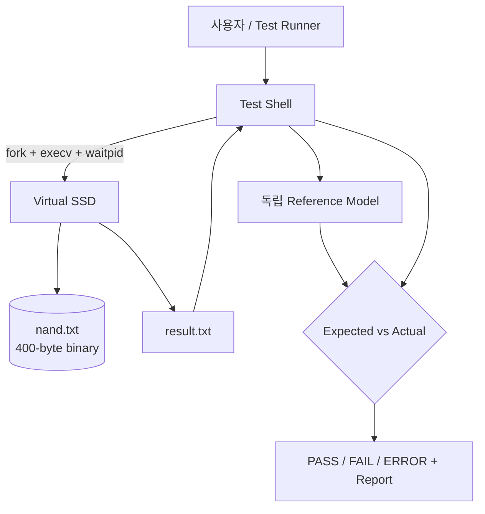

# Virtual SSD & Automated Validation Framework

[](https://github.com/psy1218/SSD-Test-shell-PJT/actions/workflows/ci.yml)

C11과 POSIX 환경에서 동작하는 100-LBA 가상 SSD와 자동 검증 프레임워크입니다.
단순 Read/Write 구현에 그치지 않고 요구사항 추적, 독립 Test Oracle, 프로세스
격리, 결함 주입, 회귀 테스트, 성능 측정, CI까지 하나의 검증 흐름으로
구현했습니다.

이 프로젝트는 파일 기반 시뮬레이터이며 실제 SSD 하드웨어나 NVMe 펌웨어를
구현한 것은 아닙니다.

## 핵심 결과

| 검증 항목 | 실제 결과 |
|---|---:|
| 일반 자동 테스트 | 42/42 PASS |
| ASan/UBSan 테스트 | 42/42 PASS |
| 독립 Oracle 시나리오 | 9/9 PASS |
| Fault 검출 및 정상 회귀 | 7/7 PASS |
| Mutation Score | 2/2, 100% |
| GCC 정적 분석 | 3/3 대상 PASS |

- LBA 99 쓰기 누락 결함과 Overwrite 무시 결함을 각각 지정 테스트에서 검출했습니다.
- 모든 테스트는 임시 디렉터리에서 실행되어 사용자의 `nand.txt`를 변경하지 않습니다.
- 로컬과 GitHub Actions가 같은 품질 게이트 스크립트를 사용합니다.

## 아키텍처



`ssd`는 테스트 대상이고 `testshell`은 실행·관찰·판정을 담당합니다. Test Shell은
SSD 내부 함수나 NAND 데이터를 정답으로 재사용하지 않습니다. 테스트 시작 시
독립적인 `uint32_t expected[100]`을 만들고, 성공한 명령에 대해서만 기대값을
갱신한 뒤 `result.txt`의 실제값과 비교합니다. 이 분리 덕분에 SSD가 잘못된
값을 반환해도 테스트가 함께 틀리는 순환 검증을 피할 수 있습니다.

## 저장 설계

- LBA: 0~99, 총 100개
- 데이터: LBA당 32비트, 총 400바이트
- 기본값: `0x00000000`
- 파일: 헤더 없는 Little Endian 바이너리 `nand.txt`
- 영속성: SSD 프로세스가 종료된 뒤에도 파일에 저장된 값 유지
- 갱신: 새 400바이트 이미지를 임시 파일에 기록·동기화한 뒤 원자적으로 교체
- 손상 처리: 기존 파일 크기가 400바이트가 아니면 자동 복구하지 않고 오류 반환

예를 들어 `0x12345678`은 파일에 `78 56 34 12` 순서로 기록됩니다. 확장자는
`.txt`지만 내용은 텍스트가 아닙니다.

## 요구 환경과 빌드

- Linux 또는 WSL
- GCC (C11)
- GNU Make
- POSIX API (`fork`, `execv`, `waitpid`, `fsync`, `rename`)

```sh
git clone https://github.com/psy1218/SSD-Test-shell-PJT.git
cd SSD-Test-shell-PJT
make
```

빌드 결과는 `ssd`, `testshell` 두 독립 실행 파일입니다.

## SSD 사용법

```sh
./ssd W 3 0x12345678
./ssd R 3
cat result.txt
# 0x12345678
```

- `W`: 지정 LBA를 갱신하며 성공 시 stdout을 출력하지 않습니다.
- `R`: 읽은 값을 `0x`와 대문자 8자리 16진수로 `result.txt`에 덮어씁니다.
- LBA는 부호 없는 10진수 0~99만 허용합니다.
- VALUE는 정확히 `0x` + 대문자 8자리 16진수만 허용합니다.
- 오류 시 stdout에는 `INVALID COMMAND`, stderr에는 진단 원인을 기록합니다.

종료 코드는 성공 0, 잘못된 명령/인자 2, 파일 I/O 3, 손상 NAND 4, 내부 오류
5입니다.

## Test Shell 사용법

```sh
./testshell
```

```text
write <LBA> <0xVALUE>
read <LBA>
fullwrite <0xVALUE>
fullread
testapp1
testapp2
testall
testcase <TEST_ID>
testsummary
help
exit
```

Test Shell은 SSD 코드를 링크해 직접 호출하지 않고, 매 명령마다
`fork()` → `execv()` → `waitpid()`로 별도 프로세스를 실행합니다. 다른 SSD
바이너리를 검증하려면 `./testshell --ssd-path <PATH>`를 사용합니다.

## 자동 테스트 방법

가장 쉬운 최종 검증 명령은 다음 하나입니다.

```sh
sh scripts/run_all_tests.sh
```

이 스크립트는 깨끗한 빌드부터 일반 테스트, ASan/UBSan, Fault Injection,
정상 회귀, GCC 정적 분석, 최종 증적 생성을 순서대로 실행합니다. 마지막에
`QUALITY GATE PASS`가 출력되면 전체 게이트를 통과한 것입니다.

목적별로 따로 실행할 수도 있습니다.

```sh
make test             # 일반 테스트 42개
make test-sanitize    # ASan/UBSan 적용 테스트 42개
make fault-test       # 의도적 결함 검출 + 정상 SSD 회귀
make analyze          # GCC -fanalyzer -Werror
make benchmark        # 실제 5회 반복 성능 보고서 갱신
./testshell --run-tests
./testshell --run-test TC-F003
```

비대화형 Test Shell 종료 코드는 전부 PASS 0, 테스트 FAIL 1, 환경 ERROR 2입니다.
자동 테스트가 생성하는 최신 증적은 다음 위치에 있습니다.

- `logs/test_result.log`
- `logs/test_summary.txt`
- `reports/test_report.csv`
- `reports/test_report.md`

## 테스트 전략

| 범주 | 검증 내용 |
|---|---|
| 저장 계층 | 생성, 초기값, 경계 LBA, 영속성, Little Endian, 손상 감지 |
| CLI | 정상 W/R, 형식 오류, 범위 오류, 출력 파일 및 종료 코드 계약 |
| Test Shell | 기본 명령, 긴 입력, 잘못된 입력, 자식 프로세스 상태 처리 |
| Oracle | 미기록 값, Overwrite, 주소 분리, 전체 영역 패턴 |
| 시나리오 | TestApp1 전체/주소 패턴, TestApp2 반복 Overwrite |
| 결함 주입 | LBA 99 쓰기 누락, 기존 값 Overwrite 무시 |
| 품질 | 경고, ASan, UBSan, `-fanalyzer`, CI 회귀 |

각 Oracle 테스트는 `/tmp` 아래 독립 디렉터리와 0으로 초기화된 Reference
Model을 사용하므로 실행 순서나 기존 사용자 데이터에 의존하지 않습니다.

## 결함 검출 결과

| 의도적 결함 | 검출 테스트 | 기대값 | 실제값 | 결과 |
|---|---|---:|---:|---:|
| LBA 99 Write 누락 | TC-B002 | `0xFFFFFFFF` | `0x00000000` | 검출 |
| Overwrite 무시 | TC-F003 | `0x12345678` | `0xAAAABBBB` | 검출 |

결함 빌드가 단순히 비정상 종료했기 때문에 성공 처리한 것이 아닙니다. 결함 SSD가
종료 코드 0을 반환한 상황에서도 독립 Oracle이 데이터 불일치를 찾아 Test Shell이
1을 반환하는지 확인합니다. 이후 정상 SSD의 9개 Oracle 테스트가 모두 다시
통과해야 `make fault-test`가 성공합니다.

재현 명령과 원인 분석은 [결함 보고서](logs/defect_report.md)에 기록했습니다.

## 성능 측정 결과

Ubuntu 24.04 WSL2, Windows 마운트 경로, GCC 13.3.0 `-O2` 환경에서 항목별
5회 측정한 결과입니다.

| Metric | 평균 (ms) |
|---|---:|
| 별도 프로세스 Write 100회 | 625.328 |
| 별도 프로세스 Read 100회 | 614.452 |
| 직접 API Write 100회 | 408.613 |
| 직접 API Read 100회 | 0.221 |
| TestApp1 | 2879.205 |
| TestApp2 | 379.814 |
| 전체 9개 Oracle 테스트 | 5116.605 |

별도 프로세스 방식은 Read에서 실행·대기와 `result.txt` 동기화 비용이 크게
반영됐습니다. 이는 파일 기반 시뮬레이터와 해당 실행 환경의 측정값이지 실제
SSD의 IOPS나 지연시간이 아닙니다. 최소·중앙값·최대와 상세 해석은
[성능 보고서](reports/performance_report.md)에 있습니다.

## 프로젝트 구조

```text
.
├── ssd.c / ssd.h             # 저장 API와 SSD CLI
├── testshell.c                # Shell, Oracle, 테스트 러너, 보고서
├── tools/benchmark.c          # 반복 성능 측정
├── tests/                     # 계층별 자동 테스트
├── scripts/                   # 전체 게이트와 결함 검증 실행기
├── docs/                      # 요구사항·설계·테스트·운영 문서
├── logs/defect_report.md      # 결함 재현 및 원인 분석
├── reports/                   # Phase·성능·최종 검증 증적
└── .github/workflows/ci.yml   # GitHub Actions
```

## 설계 한계

- 실제 NAND Page/Block, NVMe, ECC, Wear Leveling, Garbage Collection은 구현하지 않습니다.
- 동일 NAND 파일에 대한 다중 프로세스 동시 쓰기를 보장하지 않습니다.
- 임시 파일 교체와 `fsync()`를 사용하지만 모든 전원 장애 상황의 내구성을 보장하지 않습니다.
- 기본 프로토콜이 파일 기반이라 대량 명령에서 프로세스 및 동기 I/O 비용이 큽니다.
- 공식 기준 환경은 Linux/POSIX이며 Windows 네이티브 실행은 지원 범위 밖입니다.

상세한 영향과 확장 방향은 [한계 및 개선 방향](docs/10_limitations.md)을
참고하십시오.

## 배운 점

- 기능이 실행됐다는 사실과 데이터가 정확하다는 판정은 별개의 문제입니다.
- SUT와 독립된 기대값 모델이 있어야 조용한 데이터 손상을 검출할 수 있습니다.
- Fault Injection은 테스트 코드가 실제 결함을 잡는지를 검증하는 테스트입니다.
- 실패 재현 명령, 기대값, 실제값, 종료 코드를 함께 남겨야 분석과 회귀가 빨라집니다.
- 평균 성능값 하나보다 측정 범위와 환경, 포함된 비용을 함께 설명해야 합니다.

## 문서 안내

- [요구사항과 추적성](docs/01_requirements.md)
- [시스템 아키텍처](docs/02_architecture.md)
- [인터페이스 명세](docs/03_interface_spec.md)
- [NAND 저장 포맷](docs/04_storage_format.md)
- [테스트 계획](docs/05_test_plan.md)
- [요구사항-테스트 매트릭스](docs/06_test_matrix.md)
- [Fault Injection](docs/07_fault_injection.md)
- [성능 측정과 해석](docs/08_performance.md)
- [품질 게이트와 CI](docs/09_quality_ci.md)
- [한계 및 개선 방향](docs/10_limitations.md)
- [시연 및 면접 설명 가이드](docs/11_demo_interview_guide.md)
- [최종 검증 보고서](reports/final_validation.md)
